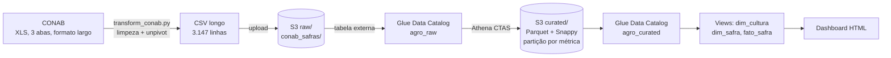

# Pipeline de dados de safras de grãos do Brasil (AWS S3 + Glue + Athena)

> **English summary.** An end-to-end data pipeline on AWS built over the official CONAB historical series of Brazilian grain crops (1976/77 to 2026/27). A wide-format Excel file is cleaned and unpivoted, landed in a raw layer on Amazon S3 as CSV, cataloged in the AWS Glue Data Catalog, converted with Athena CTAS to partitioned Parquet (curated layer), and exposed through a dimensional model (one fact table, two dimensions) built as Athena views. The same query scans **252.58 KB on CSV vs 6.16 KB on Parquet (about 41x less data)**. A self-contained HTML dashboard on top of the model is included in `docs/`.

**Dashboard:** abra `docs/index.html` no navegador (ou publique a pasta `docs/` no GitHub Pages).

## Resultado em uma frase

Converti uma planilha de séries históricas da CONAB em um pipeline com camadas raw e curated no S3, catálogo no Glue e modelo dimensional no Athena, validado contra o total oficial da fonte. A mesma consulta passou de **252,58 KB** lidos no CSV para **6,16 KB** no Parquet particionado.

## Arquitetura



| Camada | Local | Formato | Papel |
|---|---|---|---|
| Original | `raw/conab_safras_original/` | XLS | Dado bruto, intocado, para rastreabilidade |
| Raw | `raw/conab_safras/` | CSV (longo) | Dado limpo estruturalmente, ainda sem tipos finais |
| Curated | `curated/conab_safras/` | Parquet + Snappy, particionado por `metrica` | Dado tipado e pronto para consulta |
| Modelo | views no Athena | n/a | Fato e dimensões para BI |

## Resultados medidos

| Medida | Valor |
|---|---|
| Linhas no CSV longo | 3.147 (1.049 por métrica) |
| Culturas / safras | 16 / 51 (1976/77 a 2026/27) |
| Linhas na tabela fato | 896 |
| Dados lidos pela mesma consulta, CSV (raw) | 252,58 KB |
| Dados lidos pela mesma consulta, Parquet (curated) | 6,16 KB |
| Redução | cerca de 41 vezes |
| Soma da produção em 2024/25 (fato) | 352.266,3 mil t (linha BRASIL da CONAB: 352.266,0) |

Nota sobre custo: o Athena cobra por dados lidos, com mínimo de 10 MB por consulta. Neste dataset pequeno (cerca de 250 KB) a economia em dólar é nula. O ganho em bytes lidos é o que escala quando o volume cresce.

## Problemas de qualidade encontrados na fonte e como foram tratados

1. **Cabeçalho corrompido pelo Excel.** A safra 2007/08 virou o número `250,875` nas três abas. Corrigido em `transform_conab.py`, que falha de forma explícita se aparecer qualquer outro cabeçalho inesperado.
2. **Dupla contagem.** As linhas `MILHO TOTAL`, `FEIJÃO TOTAL` e `AMENDOIM TOTAL` repetem as sub-safras. Ficam marcadas em `eh_agregado` e fora da tabela fato.
3. **Zero que significa "sem dado".** O traço da planilha era o número 0. Mantê-lo faria parecer que a canola produziu zero em 1980. Viraram valores ausentes e não entram no CSV.
4. **Total oficial que não fecha com a soma.** Entre 2003/04 e 2011/12 a linha BRASIL da CONAB difere da soma das culturas em até 1,3% na área e 2,2% na produção (pior caso: 2005/06). A causa não é conhecida; está documentada como divergência da fonte, sem ajuste.
5. **Algodão em duas unidades.** A área é de algodão em pluma, mas produtividade e produção são de caroço. A produtividade publicada pela CONAB é usada como está e não é recalculada.
6. **Previsão misturada ao histórico.** A safra 2026/27 é estimativa de novembro/2026 e recebe o sinalizador `is_previsao`.
7. **Booleans em maiúscula.** O CSV traz `True`/`False`, que o parser do Athena não reconhece como boolean. Na camada raw ficam como texto e são convertidos no CTAS.

## Decisões de projeto e o porquê

- **CSV longo em vez de largo.** Uma coluna por safra (51 colunas) não funciona bem em SQL nem em BI. O formato longo (uma linha por cultura, safra e métrica) é o que o Athena e o Power BI esperam.
- **Tabela externa.** `DROP TABLE` não apaga o dado no S3. O dado bruto nunca depende de uma tabela.
- **Pastas separadas para o XLS e o CSV.** O Athena lê tudo dentro da pasta do `LOCATION`. Misturar os dois faria o Athena tentar ler o binário do XLS como texto.
- **Parquet com Snappy.** Armazenamento em colunas: uma consulta que usa só duas colunas lê só essas duas.
- **Partição por `metrica`.** É sobretudo uma demonstração da técnica. Em produção, só se particiona quando os arquivos passam de cerca de 128 MB; aqui ela cria três arquivos minúsculos.
- **Views em vez de tabelas para o modelo.** Não custam armazenamento e sempre refletem a camada curated.
- **Chaves naturais** (`cultura`, `ano_inicio`) em vez de IDs numéricos. Em uma view, um ID gerado com `row_number()` mudaria se surgisse uma cultura nova.
- **`DECIMAL(18,3)` na fato.** Elimina ruído de ponto flutuante (somar `double` dava `1159.6999999999998`).
- **`grupo_cultura` é regra minha.** A classificação em Oleaginosas, Cereais, Leguminosas e Fibras não vem da CONAB. O algodão está em "Fibras"; quem o tratasse como oleaginosa mudaria os totais por grupo.

## Como reproduzir

Requisitos: Python 3 com `pandas` e `xlrd`; uma conta AWS com S3, Glue e Athena.

1. Baixe o XLS da CONAB (série histórica de grãos por produto) em
   https://www.gov.br/conab/pt-br/atuacao/informacoes-agropecuarias/safras/series-historicas/graos/graos-por-produtos/brasilprodutoseriehist.xls/@@download/file
2. Gere o CSV: `python scripts/transform_conab.py BrasilProdutoSerieHist.xls data/conab_safras_graos_longo.csv`
   (o script imprime a validação contra a linha BRASIL). O CSV já gerado está em `data/`.
3. Crie um bucket S3 privado (Block Public Access ligado, criptografia SSE-S3) com as pastas `raw/conab_safras/`, `raw/conab_safras_original/` e `curated/`, e suba o CSV e o XLS.
4. No Athena, defina um local de resultados (por exemplo `s3://<SEU-BUCKET>/athena-results/`) e rode, **uma instrução por vez**, os arquivos de `sql/` na ordem 01 a 06, trocando `<SEU-BUCKET>` pelo seu bucket.

## Estrutura do repositório

```
data/    CSV longo gerado pela transformação
scripts/ transform_conab.py (limpeza, unpivot e validação)
sql/     DDL, CTAS, views do modelo, validações e benchmark
docs/    dashboard HTML autocontido (index.html)
```

## Limitações conhecidas

- **Dataset pequeno.** O ganho do Parquet aparece em bytes lidos, não em dinheiro. Para um teste de escala, a PAM do IBGE por município teria centenas de milhares de linhas (não testada aqui).
- **Dashboard sem conexão ao vivo.** Os dados estão embutidos no HTML, extraídos do mesmo CSV. Uma camada de BI de produção usaria o conector ODBC do Athena com uma função do IAM de menor privilégio.
- **Carga manual.** Não há orquestração: o upload e a execução do SQL são manuais. Um próximo passo natural seria agendar a atualização (por exemplo com EventBridge e Step Functions, ou Airflow).
- **Divergência na fonte** da linha BRASIL (item 4 acima) permanece sem explicação.

## Segurança

Bucket privado com Block Public Access, criptografia SSE-S3, nenhuma chave de acesso no repositório e nenhum identificador de conta nos arquivos. As consultas usam o placeholder `<SEU-BUCKET>`.

## Fonte dos dados

CONAB, série histórica de safras de grãos por produto (estimativa de novembro/2026). Dados públicos.
